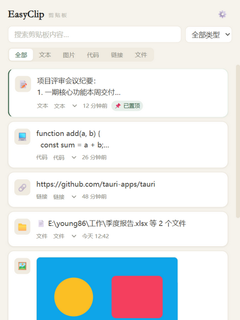
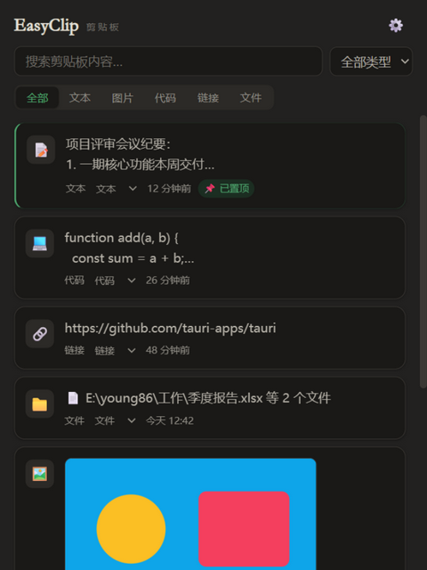

# EasyClip

<div align="center">

**轻量优雅的 Windows 剪贴板管理器**

实时捕获 · 本地持久化 · 自动分类 · 敏感信息检测 · 纸墨双主题

`Tauri 2` `React 18` `Rust` `SQLite`

</div>

<div align="center">

| 纸白 | 墨色 |
|:---:|:---:|
|  |  |

</div>

---

## ✨ 功能特性

### 剪贴板核心

- 📋 **实时捕获**：自动捕获复制的文本、代码、链接、文件列表、图片（浏览器「复制图片」的虚拟文件形态也已支持，统一转 PNG 存储）
- 💾 **本地持久化**：SQLite（WAL 模式）存储，关机不丢数据
- 🔁 **内容去重**：同一内容重复复制自动合并并置顶，不产生重复条目
- 🗂️ **自动分类**：文本 / 代码 / 链接 / 文件 / 图片智能识别，支持手动改分类
- 📌 **置顶**：常用条目常驻顶部，且不受过期清理影响
- 🔍 **搜索筛选**：关键词搜索（防抖）+ 类型下拉 / 分类页签
- 🔃 **一键回贴**：双击条目或点「复制」写回系统剪贴板（图片、文件同样支持）
- ⏳ **过期清理**：默认 14 天自动清理未置顶条目，时长可配置（1-3650 天）
- ⌨️ **全局快捷键**：`Ctrl+Shift+V` 随时唤起，关闭窗口驻留系统托盘

### 安全与隐私

- 🛡️ **敏感信息检测**：本地规则实时识别手机号、身份证（GB 11643 校验码）、银行卡（Luhn 校验）、API 密钥（OpenAI / AWS / Slack / GitHub / GitLab / Bearer）、PEM 私钥块，命中条目以朱砂徽标警示（脱敏展示）
- 🔒 **数据不出本机**：无遥测、无云端上传，数据仅存 `%APPDATA%\com.young86.easyclip\`

### 外观

- 🎨 **纸墨双主题**：参考「花笺」便签的纸墨美学——暖纸底色、四级墨色文字层次、竹青点缀、衬线排版；纸白 / 墨色一键切换

## 🗺️ 平台支持

| 平台 | 状态 |
|---|---|
| Windows 10 / 11 (x64) | ✅ 当前版本已支持 |
| macOS | 🗺️ 规划中（需重写剪贴板层为 NSPasteboard） |
| Linux | 🗺️ 规划中（X11 / Wayland 剪贴板） |

> 剪贴板捕获与写回层为 Windows 专属实现（`clipboard-win` / Win32 / OLE 数据对象）。
> 存储、分类、敏感检测、UI 与 Tauri 框架本身均为跨平台设计，其余平台的适配主要是替换剪贴板层与打包目标（DMG / AppImage / deb），欢迎贡献。

## 🚀 快速开始

### 安装使用

前往 [Releases](https://github.com/young9682/easyclipo/releases) 下载 `EasyClip_x.y.z_x64-setup.exe` 安装，或从源码构建。

### 从源码构建

**环境要求**：Windows 10/11、Rust（MSVC toolchain）+ Visual Studio Build Tools（C++ 桌面开发）、Node.js ≥ 20、pnpm ≥ 10

```bash
# 安装依赖（pnpm v10+ 构建脚本白名单已在 pnpm-workspace.yaml 配置好）
pnpm install

# 开发模式（热重载）
pnpm tauri dev

# 构建生产安装包（NSIS）
pnpm tauri build
# → src-tauri/target/release/bundle/nsis/EasyClip_<版本>_x64-setup.exe

# 运行 Rust 单元测试（存储 / 分类 / 检测 / 图像转换 / 剪贴板协议）
cargo test --manifest-path src-tauri/Cargo.toml

# 纯浏览器预览 UI（内置 mock 数据，无需 Tauri 环境）
pnpm dev
```

> ⚠️ 若绕过 Tauri CLI 直接 `cargo build --release`，必须带 `--features custom-protocol`，否则 exe 会尝试连接开发服务器而非嵌入资源，启动后报「拒绝连接」。

## 📐 架构

```
easyclipo/
├── src-tauri/            # Rust 后端（Tauri 2）
│   └── src/
│       ├── main.rs       # 入口：托盘、全局快捷键、周期清理
│       ├── commands.rs   # Tauri 命令层（前端 invoke 入口）
│       ├── clipboard/    # 剪贴板监听 / 写回 / 分类 / 图像转换
│       │                 #   800ms 轮询 + 失败重试 + OLE 虚拟文件读取
│       ├── storage/      # SQLite 存储模块
│       ├── ai/           # 敏感信息检测规则库
│       └── sync/         # 跨端同步（二期骨架）
├── src/                  # React 前端
│   ├── components/       # 界面组件（纸墨主题）
│   ├── stores/           # Zustand 状态管理
│   ├── hooks/            # 后端事件订阅（clip:new / clip:purged）
│   └── utils/            # Tauri API 封装（浏览器环境回退 mock）
├── sync-server/          # 同步服务器（二期，独立工程）
└── scripts/              # 图标生成脚本
```

**剪贴板读取链路**（按可靠性与质量取首个可读格式）：
文本 → 真实文件列表（路径须存在）→ `image/png` 注册格式（浏览器复制图片）→ CF_DIB 直读 → OLE FileContents 流（Edge/Chromium 虚拟文件）→ CF_BITMAP 兜底

## 🗂️ Roadmap

- [ ] **跨端同步**：WebSocket 自建服务器（`sync/`、`sync-server/` 骨架已就绪），设备令牌鉴权、增量同步、断线重连；敏感条目默认不同步
- [ ] **AI 敏感检测**：在规则库之上接入 Ollama（本地）或 Claude API（语义级检测）
- [ ] **数据库加密**：SQLCipher（当前为普通 SQLite）
- [ ] **跨平台**：macOS / Linux 剪贴板层适配
- [ ] 单实例锁、开机自启、更多回贴目标

## 🙏 致谢

- 界面设计灵感来自 [floral-notepaper（花笺）](https://github.com/Achilng/floral-notepaper)——一款优雅的跨平台便签工具，其纸墨美学令牌为本项目主题所借鉴（实现为独立编写的 Tailwind 代码）
